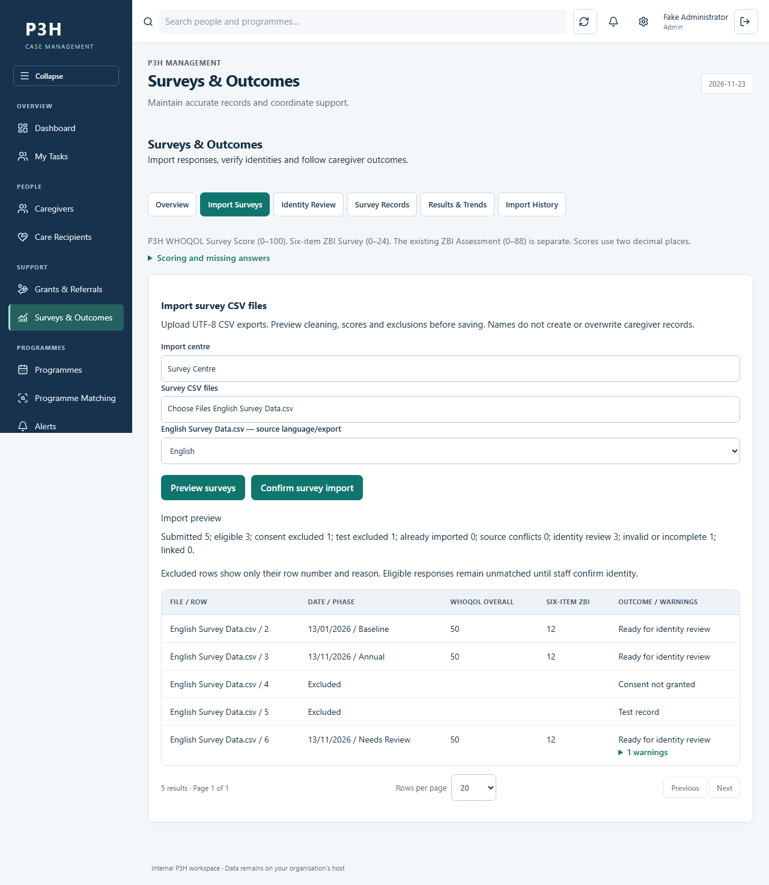
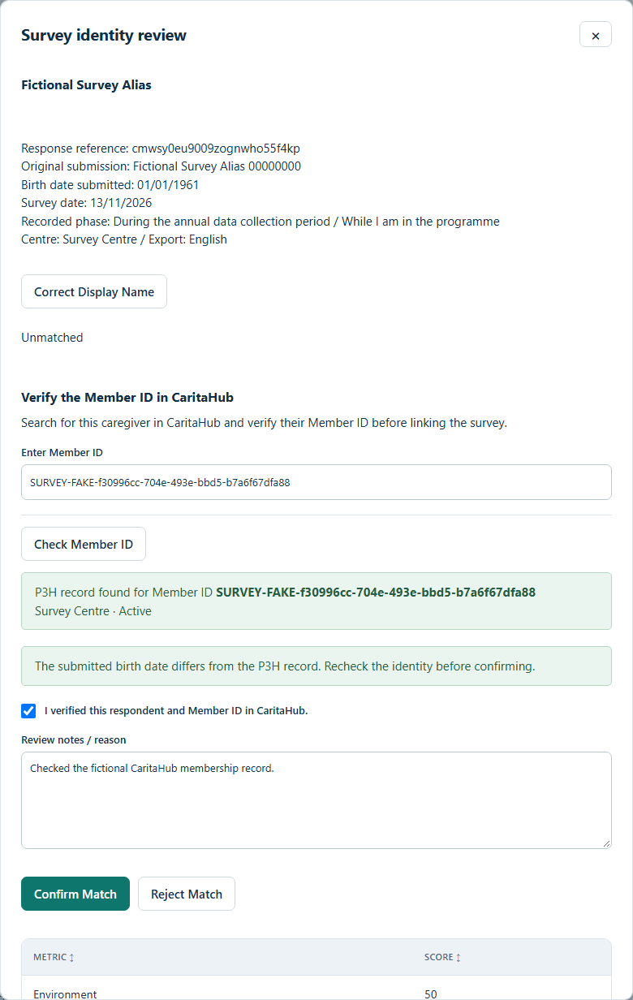

# Import surveys and verify Member IDs

The screenshots use fictional data.

## Preview and import

Open **Surveys & Outcomes → Import Surveys**. Choose the survey centre and CSV language, select the file, then choose **Preview surveys**. Check the excluded, duplicate and incomplete counts before choosing **Confirm survey import**. Eligible responses are ready for identity review.

## Verify and link

1. Open **Identity Review** and select **Review identity** on a response.
2. Open CaritaHub separately using your authorised account. Check the submitted name or initials against the approved records and verify the Member ID.
3. Enter the exact Member ID in P3H and choose **Check Member ID**. Check the response reference, Member ID, centre and status. Investigate discrepancies before proceeding.
4. Enter a brief verification note, tick the CaritaHub confirmation and choose **Confirm Match**. Use **View Survey History** on a linked response to open the caregiver's results.

Use **Correct Display Name** for a spelling correction. Leave the response unmatched if the ID is missing from P3H or the identity is uncertain. A manager can use **Unlink Survey** to reverse a mistake. [Full staff guide](surveys-staff-guide.md)
